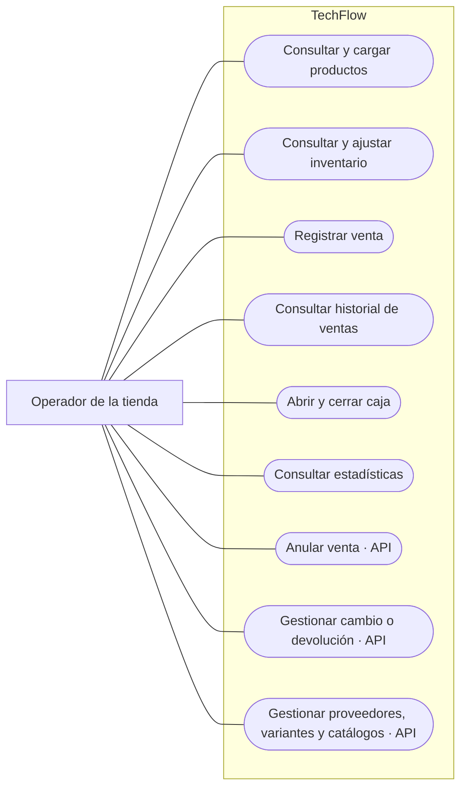
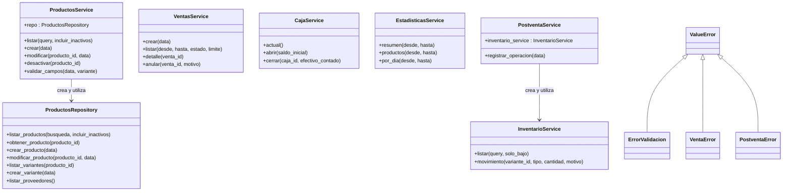
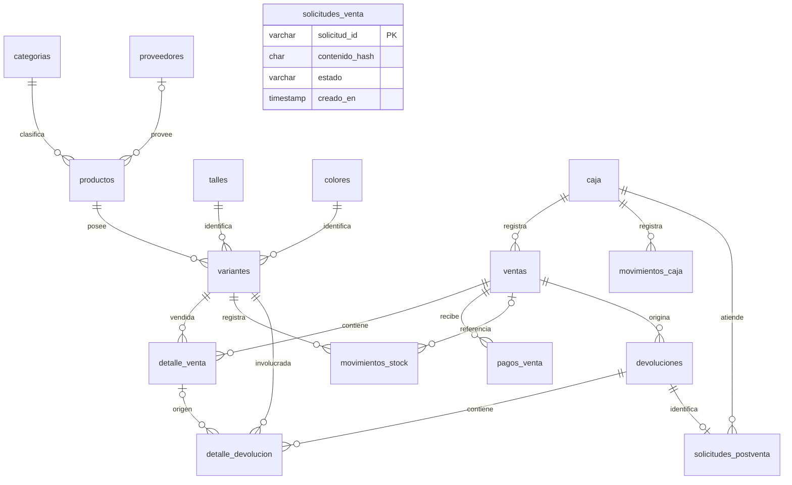
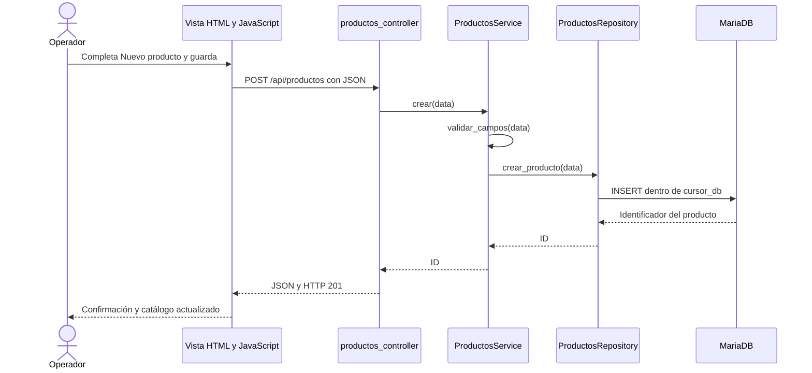

# TechFlow: guía para la exposición

Basada en el código y el esquema SQL revisados el 9 de noviembre de 2026. Describe la implementación actual, no funciones futuras. No se modificó el programa para preparar esta guía.

## 1. Presentación del sistema

«TechFlow es una aplicación web para gestionar una tienda de indumentaria. Permite consultar y cargar productos, controlar existencias por talle y color, registrar ventas con distintos medios de pago, administrar la caja y consultar estadísticas. Además, dispone de operaciones de cambios y devoluciones mediante su API.»

El operador utiliza el navegador. JavaScript envía solicitudes HTTP a Flask; el servidor valida la operación y consulta o modifica MariaDB. La respuesta vuelve en JSON y la interfaz se actualiza.

## 2. Casos de uso

El actor actual es **Operador de la tienda**. Vendedor y encargado pueden ser roles del negocio, pero el programa no implementa cuentas, autenticación ni permisos diferenciados. El cliente participa en la compra física; no utiliza directamente esta aplicación. El proveedor es una entidad registrada, no un usuario externo del sistema. La base de datos es infraestructura interna, no un actor de negocio.

Este esquema Mermaid es una representación visual de los casos de uso. La fuente UML con actor, elipses y límite del sistema se encuentra en `casos-uso-techflow.puml`.



Las operaciones marcadas API existen en el servidor, pero no tienen una interfaz completa dedicada. No presentarlas como botones disponibles en la pantalla. La edición y desactivación de productos también se exponen por API.

### Caso principal: registrar una venta

- Actor: operador.
- Precondiciones: caja abierta, variantes activas disponibles y cantidades válidas.
- Flujo: seleccionar variantes; indicar cantidades; agregar al carrito; seleccionar medios e importes; indicar efectivo recibido si corresponde; confirmar.
- El servidor vuelve a consultar precios, comprueba existencias y pagos, guarda venta y detalles, registra pagos, descuenta stock y registra el efectivo en caja.
- Resultado: venta confirmada, vuelto informado e inventario actualizado.
- Alternativas: stock insuficiente, caja cerrada o pagos incorrectos producen rechazo. Si falla una escritura, la transacción revierte los cambios. Una repetición de la misma solicitud válida recupera el resultado sin duplicar la venta.

No dibujar «Abrir caja» como un include obligatorio de cada venta: tener una caja abierta es una precondición, y una misma apertura sirve para muchas ventas. Un pago con tarjeta se registra; no se procesa un cobro bancario real.

## 3. Diagrama UML de clases de implementación

UML es una familia de diagramas: el de casos de uso también es UML. Para explicar POO conviene agregar el **diagrama de clases**. Este diagrama muestra las clases principales reales, con métodos representativos; no pretende enumerar todas las funciones.



Se simplificó la firma de `InventarioService.movimiento`: también admite `diferencia`, `cursor` y `venta_id`. Los controladores son módulos con funciones y Blueprints, no clases propias. `cursor_db` es una función/context manager: no debe dibujarse como una clase inventada. Tampoco corresponde presentar las tablas ventas y caja como clases Python inexistentes.

## 4. Relaciones de la base de datos

El esquema tiene **16 tablas**. Este diagrama de entidades y relaciones complementa al UML de clases; no lo reemplaza.



Las cardinalidades reflejan las claves foráneas: por ejemplo, la base permite una venta sin detalles aunque el servicio exige ítems para crearla. `solicitudes_venta.solicitud_id` y `ventas.solicitud_id` se vinculan por la lógica de aplicación, pero no hay una FK declarada entre ellas. La unicidad de `solicitudes_postventa.devolucion_id` permite como máximo una solicitud por operación. Un registro antiguo de devolución puede carecer de ella.

## 5. Normalización: qué se puede afirmar

**La base cumple 1FN y, bajo las dependencias de negocio actuales, 2FN. Muchas tablas siguen 3FN, pero el esquema completo no es estrictamente 3FN.** Hay redundancias y datos calculados almacenados que deben mantenerse consistentes.

### Primera forma normal

Cada fila tiene una clave primaria y cada columna guarda un valor del dominio correspondiente. Los artículos de una venta se guardan como filas en `detalle_venta`, no como listas de productos dentro de una celda. Los pagos múltiples se separan en `pagos_venta`.

### Segunda forma normal

Además de 1FN, ningún atributo no primo debe depender de solo una parte de una clave candidata compuesta. No basta con decir «todas tienen un id». También deben examinarse claves alternativas.

Ejemplo: `variantes` tiene como claves candidatas `id`, `codigo` y `(producto_id, talle_id, color_id)`. Stock y mínimo corresponden a la variante completa, no solo al producto o al talle. El precio del producto queda en `productos`, en lugar de repetirse como precio actual de todas sus variantes.

### Tercera forma normal y excepciones

3FN exige que, para una dependencia funcional no trivial X → A, X sea superclave o A sea atributo primo. En términos prácticos, deben evitarse dependencias de atributos no clave a través de otros atributos no clave.

Ejemplo bien separado: `productos.categoria_id` referencia `categorias.id`; el nombre de la categoría se guarda en `categorias`, no se repite en cada producto. Los datos del proveedor también están en otra tabla.

Contraejemplos concretos del esquema actual:

- `detalle_venta.subtotal = cantidad × precio_unitario`. La pareja cantidad/precio determina subtotal, pero no identifica una fila: distintos artículos pueden tener la misma cantidad y precio. Es una dependencia entre atributos no clave.
- `caja.diferencia = efectivo_contado − efectivo_esperado`. Se guarda el resultado de un cálculo cuyos operandos también están en la fila.
- Para líneas devueltas de `detalle_devolucion`, `detalle_venta_id` determina la variante y el precio histórico de origen, que también se almacenan. Existe redundancia condicionada por el tipo de línea.

Además, `ventas.total`, `ventas.medio_pago`, `variantes.stock_actual` y `devoluciones.total_diferencia` conservan resúmenes o valores mantenidos junto con el detalle. No todo agregado entre tablas es, por sí mismo, una prueba formal de violación de 3FN; sí implica datos redundantes y obligaciones de consistencia.

**Precio histórico no es lo mismo que precio actual.** `detalle_venta.precio_unitario` conserva el precio pactado en esa venta. `productos.precio` puede cambiar después. Guardar ambos es necesario para no alterar el historial y no constituye por sí solo una dependencia indebida.

Frase para exponer: «Separamos las entidades y los detalles para reducir duplicación y anomalías. El diseño cumple segunda forma normal y gran parte está en tercera, pero conservamos algunos cálculos y resúmenes. Por eso no afirmamos tercera forma normal estricta en toda la base. Los servicios mantienen estos valores dentro de transacciones.»

Una mejora posible sería calcular ciertos resultados al consultar, o mediante vistas, y revisar la separación de líneas de devolución. No hace falta modificar ahora el esquema para explicarlo con honestidad.

## 6. Lenguajes y tecnologías

| Elemento | Función real en el proyecto |
|---|---|
| Python | Lógica de negocio, validaciones, rutas y acceso a datos. |
| Flask | Framework web: servidor de aplicación, rutas, Blueprints, respuestas y plantillas. |
| HTML | Estructura de la interfaz; es lenguaje de marcado. |
| CSS | Estilos y distribución visual; es lenguaje de estilos. |
| JavaScript | Eventos, carrito, formularios, consultas con fetch y actualización del DOM. |
| SQL | Definición de tablas, restricciones y consultas de datos. |
| MariaDB en XAMPP | Motor relacional utilizado en el entorno local verificado. |
| InnoDB | Motor de almacenamiento de las tablas, con transacciones y claves foráneas. |
| mysql-connector-python | Conexión entre Python y el servidor SQL. |
| python-dotenv | Carga de configuración desde variables de entorno/archivo .env. |
| Jinja, mediante Flask | Renderizado de la plantilla inicial `index.html`; gran parte de la actualización posterior ocurre en JavaScript. |
| JSON y HTTP | Formato de intercambio y protocolo de comunicación navegador-servidor. |
| Git | Control de versiones del repositorio. |

Dependencias declaradas: Flask 3.1.3, mysql-connector-python 9.5.0 y python-dotenv 1.2.1. Son versiones de `requirements.txt`; no una afirmación sobre cualquier computadora donde se ejecute.

XAMPP es un paquete de herramientas, no un lenguaje. Apache no es necesario para ejecutar este proyecto con Flask. El panel puede estar cerrado mientras MariaDB sigue activo.

El comando npm start lanza python run.py. El backend es Flask; no se utiliza Node, Express, React ni un ORM como SQLAlchemy.

## 7. POO: cómo, cuándo y por qué

El programa **utiliza orientación a objetos junto con funciones**. No es un diseño de dominio enteramente orientado a objetos.

| Concepto | Evidencia | Límite que conviene reconocer |
|---|---|---|
| Clases y objetos | `service = ProductosService()` en el controlador. | Los controladores son funciones, no clases. |
| Abstracción | El controlador llama `service.crear(data)` sin escribir el INSERT. | En otros módulos el SQL está directamente en servicios. |
| Encapsulación de responsabilidades | Validación en `ProductosService`; persistencia en `ProductosRepository`. | Los atributos son públicos y varios módulos trabajan con diccionarios. No hay encapsulación estricta de estado de dominio. |
| Colaboración entre objetos | `ProductosService` crea un repositorio; `PostventaService` crea un servicio de inventario. | Las dependencias se construyen dentro del objeto, no se inyectan. |
| Herencia | `ErrorValidacion`, `VentaError` y `PostventaError` heredan de `ValueError`. | Es herencia de excepciones, no una jerarquía de productos o ventas. |
| Polimorfismo | El manejo general de `ValueError` puede tratar subtipos. | No hay un ejemplo fuerte de polimorfismo de negocio con implementaciones intercambiables. |

Cuándo ocurre: al importar el controlador se instancia su servicio. Al crear un producto, se llama un método de ese objeto; el servicio valida datos y delega en su repositorio. En posventa, un objeto de servicio utiliza otro para registrar movimientos.

Por qué se usa: permite agrupar responsabilidades, reutilizar operaciones, localizar validaciones y separar el acceso a datos de ciertas decisiones de negocio. Tener una clase no garantiza por sí solo un buen diseño POO.

Las consultas devuelven diccionarios. Las dataclasses sin uso se retiraron durante la limpieza; la POO se implementa en servicios y repositorios.

Frase para exponer: «Aplicamos POO principalmente en servicios y repositorios, donde creamos objetos con métodos y responsabilidades concretas. La implementación es mixta: también usa funciones y diccionarios. La herencia aparece en excepciones y no tenemos una jerarquía polimórfica de entidades del negocio.»

## 8. MVC: distribución y recorrido

La arquitectura está **basada en MVC y ampliada con servicios y repositorios**, con algunas separaciones incompletas.

| Parte | Archivos | Responsabilidad |
|---|---|---|
| Vista | `templates/index.html`, `static/css/estilos.css`, `static/js/inicio.js` | Mostrar información y recibir interacción. JavaScript también coordina estado local y peticiones. |
| Controlador | `app/controllers/*_controller.py` | Recibir solicitudes, leer parámetros, invocar operaciones y devolver HTML/JSON con códigos HTTP. |
| Modelo, en sentido arquitectónico | Servicios, repositorio, acceso SQL y esquema | Representar reglas y persistencia de los datos. No se limita a la carpeta `models`. |



Este es el ejemplo más claro para defender MVC. En ventas, caja e inventario los servicios también contienen SQL. El controlador de proveedores llama al repositorio directamente y valida campos. La consulta individual de producto accede a `service.repo`. Por eso no todos los módulos siguen exactamente el mismo recorrido.

Frase para exponer: «La vista se ocupa de la presentación, los controladores reciben las peticiones y el modelo reúne reglas y persistencia. Agregamos servicios y repositorios para separar responsabilidades, aunque la separación todavía no es uniforme en todos los módulos.»

## 9. Estructura de carpetas y archivos

```text
techflow/
├── app/
│   ├── __init__.py                  Crea Flask y registra rutas y errores.
│   ├── db.py                        Configuración, conexiones y transacciones.
│   ├── controllers/
│   │   ├── __init__.py              Función de compatibilidad create_app.
│   │   ├── inicio_controller.py     Página inicial y estado de conexión.
│   │   ├── productos_controller.py  Productos, variantes y catálogos.
│   │   ├── proveedores_controller.py Proveedores.
│   │   ├── inventario_controller.py Consultas, ingresos y ajustes.
│   │   ├── ventas_controller.py     Ventas, detalle y anulación.
│   │   ├── caja_controller.py       Caja actual, apertura y cierre.
│   │   ├── estadisticas_controller.py Resumen, ranking y serie diaria.
│   │   └── postventa_controller.py  Registro de cambios y devoluciones.
│   ├── services/
│   │   ├── __init__.py              Validadores compartidos y NoEncontrado.
│   │   ├── productos_service.py     Reglas del catálogo.
│   │   ├── inventario_service.py    Reglas de existencias y movimientos.
│   │   ├── ventas_service.py        Venta y anulación transaccional.
│   │   ├── caja_service.py          Apertura, cierre y conciliación.
│   │   ├── estadisticas_service.py  Consultas agregadas, incluida posventa.
│   │   └── postventa.py             Cambios, devoluciones y diferencias.
│   └── repositories/
│       └── productos_repository.py SQL de productos y catálogos/proveedores.
├── templates/
│   └── index.html                  Estructura de las pantallas.
├── static/
│   ├── css/estilos.css              Apariencia.
│   ├── js/inicio.js                Interacción y comunicación con la API.
│   └── assets/                     Imágenes, incluido el logo.
├── sql/
│   ├── techflow.sql                Instalación inicial y datos básicos.
│   ├── postventa.sql               Migración aditiva en la base seleccionada.
│   ├── techflow_demo.sql           Base paralela con datos de ejemplo.
│   ├── generar_demo.py             Genera el archivo SQL de demostración.
│   └── DEMO.md                     Instrucciones de la demo.
├── doc/documentacion.md            Documentación general previa.
├── docs/                           Revisiones y material de exposición.
├── run.py                          Inicia la aplicación en el puerto 5000.
├── run_demo.py                     Inicia la demo en el puerto 5001.
├── requirements.txt                Dependencias Python.
├── .env.example                    Ejemplo de configuración; no es código.
├── package.json                    npm start ejecuta Python.
└── README.md                       Instrucciones generales.
```

`__pycache__`, si aparece, contiene archivos generados por Python y no lógica escrita aparte. `.git` conserva el historial de versiones. No mostrar credenciales reales al exponer configuración.

## 10. Guion sugerido de 10–12 minutos

1. **Objetivo y alcance (1 minuto):** tienda, operador y problema que resuelve.
2. **Casos de uso (1 minuto):** funciones visibles y funciones solo por API.
3. **Tecnologías (1 minuto):** navegador → Flask/Python → MariaDB.
4. **Carpetas y MVC (2 minutos):** explicar una creación de producto de punta a punta.
5. **UML de clases y POO (2 minutos):** servicio, repositorio, objetos y límites reales.
6. **Base y normalización (2 minutos):** entidades separadas, detalle de venta y excepciones de 3FN.
7. **Demostración (2–3 minutos):** consultar stock, vender, comprobar vuelto, revisar inventario, historial y estadísticas.

Para la demostración usar `techflow_demo`, iniciar MariaDB y ejecutar `python run_demo.py`. Ensayar antes, porque cada venta modifica la demo y sus estadísticas. Tener capturas de respaldo.

## 11. Preguntas habituales

**¿Por qué separar producto y variante?** El producto agrupa nombre, categoría y precio; la variante identifica una combinación de talle y color, con su código y stock propios.

**¿Por qué detalle_venta?** Una venta contiene varios artículos, cada uno con cantidad y precio histórico propios. Evita columnas producto1/producto2 o listas dentro de una celda.

**¿Por qué dos bases?** `techflow_demo` permite demostrar la misma aplicación con ejemplos sin mezclar operaciones con la base principal.

**¿Postventa es otra base?** No. `postventa.sql` agrega tablas de cambios y devoluciones a la base seleccionada.

**¿Qué pasa si falla la base a mitad de una venta?** La operación se ejecuta en una transacción: se confirma completa o se revierte. El identificador de solicitud ayuda a evitar duplicados al reintentar.

**¿Qué faltaría mejorar?** Completar pantallas para las operaciones disponibles solo por API, uniformar la separación de capas y revisar redundancias del esquema. Autenticación y roles serían una ampliación para uso con distintos usuarios.

**¿Es MVC puro, POO completa y 3FN estricta?** No conviene afirmarlo. Es una implementación funcional basada en MVC, con POO en servicios/repositorios y normalización con excepciones documentadas. Poder señalar estas decisiones y límites forma parte de una buena defensa técnica.
